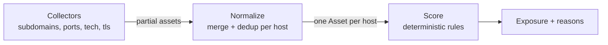

# reconforge

An attack-surface recon **aggregator**. It runs a set of pluggable collectors
against a target you are authorised to assess, normalises everything they return
into one asset model, merges and deduplicates findings per host, and scores each
asset's exposure with deterministic, explainable rules — producing a ranked
surface report rather than a pile of disconnected tool output.

> **Authorization.** Only point real collectors at systems you own or have
> explicit written permission to test. The collectors bundled here are **offline
> and synthetic** — they scan nobody — so the tool runs end to end for
> development and demos without touching any real host.

[](.github/workflows/ci.yml)
[](pyproject.toml)
[](LICENSE)

---

## The problem it solves

Recon output is fragmented: a subdomain tool, a port scanner, a tech
fingerprinter and a TLS probe each emit their own format, overlapping on the same
hosts. An analyst then stitches it together by hand. reconforge makes that
mechanical step a library: one `Collector` interface, one normalised `Asset`
model, one merge, and one scoring pass — so adding a source is implementing a
Protocol, and the exposure ranking is consistent and reproducible.

## Architecture



1. **Collect (`collectors.py`).** A `Collector` takes a target and returns partial
   `Asset` records. Discovery (subdomains) produces hosts; per-host collectors
   (ports, tech, TLS) enrich each. Real adapters over DNS, a port scanner, an HTTP
   fingerprinter or certificate transparency implement the same Protocol; the
   bundled ones derive a deterministic synthetic surface from a hash of the target
   so runs are repeatable and offline.
2. **Normalize (`normalize.py`).** Assets sharing a host are merged into one, with
   ports deduplicated by number, and technologies, TLS issues, tags and source
   labels unioned. The surface becomes one record per host regardless of how many
   tools reported it.
3. **Score (`scoring.py`).** Each asset is scored by a weighted rule set and
   mapped to a severity level. Every point in the score carries a reason.

## Scoring rules

Exposure is the sum of rule weights, so a score is always decomposable into the
findings behind it:

| Finding                                   | Weight | Severity |
| ----------------------------------------- | ------ | -------- |
| RDP (3389) / Telnet (23) exposed          | 4      | high     |
| SMB (445), MySQL, PostgreSQL, Mongo, Redis| 3 each | high     |
| TLS certificate expired                   | 3      | high     |
| Administrative panel exposed              | 3      | high     |
| End-of-life software (e.g. Apache 2.4.49) | 2 each | high     |
| FTP (21), HTTP without HTTPS, self-signed/legacy TLS | 2 | medium |
| SSH (22) exposed                          | 1      | low      |

Level thresholds: `≥12 critical`, `≥8 high`, `≥4 medium`, `≥1 low`, else `info`.
The weights are deliberately plain data and easy to tune to an organisation's
risk model. Scoring is rule-based, not learned — attack-surface judgement is
well understood and an auditable rule beats an opaque model here.

## Quick start

```bash
python -m venv .venv && source .venv/bin/activate
pip install -e ".[dev]"

python -m reconforge.cli demo                 # assess a sample target, offline
python -m reconforge.cli assess example.com
uvicorn reconforge.main:app --reload          # HTTP API
```

```bash
curl -s -X POST localhost:8000/assess -H 'content-type: application/json' \
  -d '{"target": "example.com"}'
```

## Writing a real collector

```python
class DNSCollector:
    name = "dns"

    def collect(self, target: str) -> list[Asset]:
        # query DNS; return Asset(host=..., ips=[...], sources={self.name})
        ...


service = ReconService(host_collectors=[DNSCollector(), PortCollector()])
```

Any object with a `name` and a `collect(target) -> list[Asset]` satisfies the
`Collector` Protocol and plugs straight into normalisation and scoring.

## Configuration

| Variable               | Default | Meaning                                                 |
| ---------------------- | ------- | ------------------------------------------------------- |
| `RF_ALLOW_ACTIVE_SCAN` | `false` | Real network collectors must opt in; bundled are offline|

## Testing

```bash
ruff check reconforge tests
pytest --cov=reconforge --cov-report=term-missing --cov-fail-under=80
```

Covers the collectors (determinism, common ports), normalisation (merge and
dedup), the scoring rules (clean asset → zero, exposed admin host → critical,
HTTP-without-HTTPS, end-of-life software, level thresholds), the service
(ranking, aggregation, determinism), the HTTP API, and the CLI.

## Documentation

- `docs/architecture.md` — the collector/normalize/score pipeline in depth.
- `docs/adr/` — the main design decisions and their trade-offs.
- `docs/estudio/` — a study guide in Spanish.

## License

[MIT](LICENSE) © Angelo David Padilla Romero
