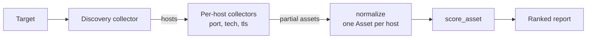

# Architecture

reconforge turns fragmented recon output into one ranked attack-surface report.
This document describes the pieces, the data flow, and the boundaries between
them.

## The pieces

| Layer        | Module                     | Responsibility                                    |
| ------------ | -------------------------- | ------------------------------------------------- |
| Model        | `reconforge/models.py`     | The `Asset` / `Port` vocabulary and exposure types|
| Collectors   | `reconforge/collectors.py` | Pluggable sources behind one `Collector` Protocol |
| Normalize    | `reconforge/normalize.py`  | Merge and deduplicate assets per host             |
| Scoring      | `reconforge/scoring.py`    | Deterministic, weighted exposure rules            |
| Orchestration| `reconforge/service.py`    | Discover → enrich → normalise → score             |
| HTTP API     | `reconforge/main.py`       | `/assess` over REST                               |
| CLI          | `reconforge/cli.py`        | Demo and single-target assessment                 |

## Data flow

## One model, many sources

The design choice that makes the tool a library rather than a script is the
single `Collector` Protocol — `name` plus `collect(target) -> list[Asset]` — and
the single `Asset` model every collector maps onto. A collector returns *partial*
assets (the port scanner fills `ports`, the TLS probe fills `tls_issues`), and
normalisation combines partials that share a host. Adding a real source (DNS,
Shodan-style passive data, an HTTP fingerprinter) is implementing the Protocol;
nothing downstream changes.

## Why the bundled collectors are offline

A recon tool that scans real hosts by default is a liability — it invites misuse
and makes tests non-deterministic and dependent on the network and on third
parties' systems. So the bundled collectors are **offline**: each derives a
plausible, repeatable surface from a SHA-256 hash of the target. The same target
always yields the same assets, so the demo and the tests are deterministic and
scan nobody. Real collectors are an explicit opt-in (`RF_ALLOW_ACTIVE_SCAN`) and
the responsibility of a deployment with authorisation.

## Normalisation

`normalize` groups assets by host and merges each field: IPs and technologies and
tags and source labels are unioned (deduplicated), and ports are deduplicated by
number (the first source to report a port keeps the service label). The result is
one `Asset` per host carrying everything every collector learned about it, with
`sources` recording which collectors contributed — useful provenance when a
finding is questioned.

## Scoring: rules, not a model

Exposure is a sum of rule weights, each rule emitting an `ExposureFinding` with a
reason and a severity. The total maps to a level (`info`/`low`/`medium`/`high`/
`critical`). This is deliberately not machine-learned: attack-surface risk is
well-understood domain knowledge, the rules are auditable and tunable per
organisation, and an analyst can see exactly why a host scored what it did. It is
the same principle as pqrs-router's deadline rules — the part with judgement and
consequences stays explicit and reviewable.

## Extension points

- **Collectors.** New sources implement the `Collector` Protocol.
- **Rules.** `_PORT_RULES`, `_TLS_RULES`, `_RISKY_TECH` and the level thresholds
  are plain data, tuned to a risk model.
- **Model.** `Asset` can carry more fields (CVEs, WAF presence, geolocation)
  without changing the pipeline shape.
